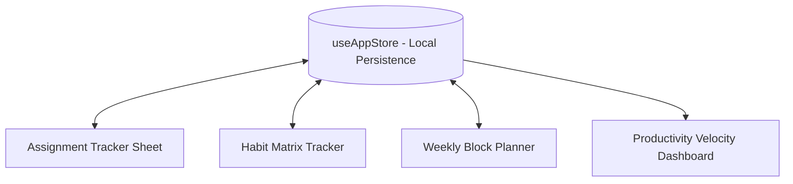

# Karnex Tracker (Momentum Workspace) — Student Academic & Habit Productivity Suite

> An integrated academic task manager, habit consistency matrix, weekly time-blocking planner, and performance analytics suite engineered for engineering students.

[](https://react.dev/)
[](https://developer.mozilla.org/en-US/docs/Web/JavaScript)
[](https://vitejs.dev/)

---

## Executive Overview

Karnex Tracker (`KarnexTracker`) is an integrated student productivity workspace developed to help engineering and computer science students manage demanding course workloads. Built around structured time management methodologies, the application combines assignment tracking spreadsheets, daily habit compliance grids, weekly class scheduling blocks, and cumulative velocity reporting within a single cohesive dashboard.

---

## Core Capabilities & Features

### Implemented Features
- **Assignment & Course Tracker (`AssignmentTrackerSheet.jsx`):** Spreadsheet-style course assignment table with priority flags, course tags, and due-date filters.
- **Habit Consistency Matrix (`HabitTrackerSheet.jsx`):** Daily habit completion tracking featuring streak counters and historical compliance percentages.
- **Weekly Block Planner (`WeeklyPlanner.jsx`):** Interactive weekly calendar grid for scheduling lectures, laboratory sessions, and focused coding sprints.
- **Cumulative Productivity Reports (`ReportDashboard.jsx`):** Visual analytical charts tracking task completion velocity and habit retention rates.
- **Reactive Local Storage Store (`useAppStore.js`):** Lightweight client-side persistence guaranteeing instant offline-first operation.

---

## System Architecture



---

## Directory Structure

```text
KarnexTracker/
├── src/
│   ├── assets/
│   │   ├── hero.png                 # Workspace visual banner
│   │   └── react.svg                # Static icons
│   ├── components/
│   │   ├── AssignmentTrackerSheet.jsx # Assignment management spreadsheet
│   │   ├── Dashboard.jsx            # Unified dashboard view
│   │   ├── HabitTracker.jsx         # Habit counter cards
│   │   ├── HabitTrackerSheet.jsx    # Matrix compliance grid
│   │   ├── ReportDashboard.jsx      # Cumulative velocity reporting
│   │   ├── TaskTracker.jsx          # Quick-action task drawer
│   │   └── WeeklyPlanner.jsx        # Weekly time-block scheduler
│   ├── store/
│   │   └── useAppStore.js           # Reactive state and local persistence
│   ├── App.jsx                      # Primary application component
│   └── main.jsx                     # React DOM entrypoint
├── public/                          # Favicon and brand assets
├── package.json                     # Project manifest and build scripts
└── README.md                        # Master repository technical documentation
```

---

## Setup & Installation

```bash
git clone https://github.com/StratagemVX/KarnexTracker.git
cd KarnexTracker
npm install
npm run dev
```

---

## Contributor Attribution & Profile

- **Developer:** Chethan Kumar B S (`StratagemVX`)
- **Institution:** Department of Computer Science & Engineering, MVJ College of Engineering
- **GitHub:** [https://github.com/StratagemVX](https://github.com/StratagemVX)
- **Portfolio:** [https://chethan-kumar-portfolio.vercel.app/](https://chethan-kumar-portfolio.vercel.app/)
- **LinkedIn:** [https://linkedin.com/in/chethan-kumar-b-s-781a002bb](https://linkedin.com/in/chethan-kumar-b-s-781a002bb)

## Verification and maintenance

Keep the overview, setup instructions, feature claims, and architecture aligned with the current source and dependency manifests.

### Available package scripts

- `npm run dev` — `vite`
- `npm run build` — `vite build`
- `npm run lint` — `eslint .`
- `npm run preview` — `vite preview`

These commands are defined in the package manifest; their execution status is not asserted here.

### Contribution and security notes

- Update screenshots and diagrams when the UI or system design changes.
- Keep credentials, private keys, personal data, and local environment files out of version control.
- Use placeholder-only examples and deployment-managed secrets.
- Provide reproducible defect reports with expected and actual behavior.
- Run relevant build, lint, and test checks before merging.
