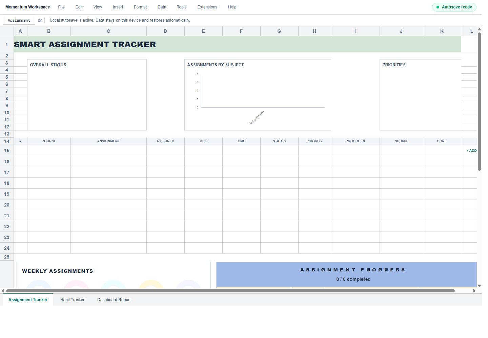
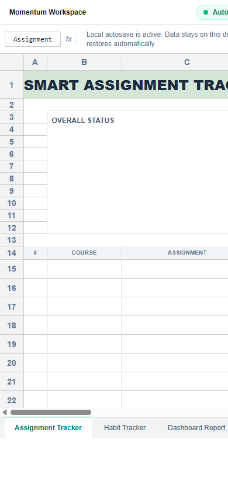

# Momentum Workspace

A local-first productivity web app built with React, Vite, Tailwind CSS, Zustand, and Recharts. Momentum Workspace presents a spreadsheet-style workbook for tracking assignments, habits, and progress reports with automatic local saving.

## Features

- Assignment Tracker with editable rows for course, assignment title, dates, status, priority, progress, submission type, and completion date.
- Compact professional assignment table with status/priority pills and progress bars.
- Habit Tracker with top daily habits, monthly checkbox tracking, weekly charts, and live completion totals.
- Dashboard Report with assignment data, habit progress tables, weekly progress rings, monthly trend charts, and printable report export.
- Real-time analytics that update immediately as assignments or habits are edited.
- Automatic local autosave with restore on refresh or revisit.
- Header save indicator showing restore/save status.
- Local-only storage: data remains on the user's device.

## Output Photographs

### Desktop View



### Mobile View



## Workbook Tabs

### Assignment Tracker

The main assignment workspace. It includes:

- Overall status chart
- Assignments by subject chart
- Priority chart
- Editable assignment table
- End-of-page assignment analytics:
  - Weekly assignment progress rings
  - Assignment progress table
  - Assignment trend chart

### Habit Tracker

The habit workspace includes:

- Top 10 daily habits list
- Daily checkbox grid for a 31-day month
- Weekly habit charts
- Live progress calculations based on checked habit days

### Dashboard Report

The reporting view combines assignment and habit insights:

- Editable assignment report table
- Weekly habit charts
- Habit grids
- Daily progress summary
- Weekly donut progress
- Monthly trend chart
- Printable report download

## Autosave And Local Restore

The app uses Zustand persistence with `localStorage`.

Saved data includes:

- Assignments
- Habits
- Habit checkbox logs
- Weekly planner tasks
- Weekly planner categories
- Last saved timestamp

Behavior:

- Every user edit updates the local store automatically.
- Data is restored when the page is refreshed or reopened in the same browser.
- No manual save button is required.
- Data is stored locally on the device and is not sent to a server.

Browser note: clearing site data, using private/incognito mode, or changing browsers/devices can remove or hide saved data.

## Tech Stack

- React 19
- Vite 8
- Tailwind CSS 4
- Zustand 5
- Recharts
- date-fns
- react-to-print
- lucide-react

## Getting Started

Install dependencies:

```bash
npm install
```

Run the development server:

```bash
npm run dev
```

Open:

```text
http://127.0.0.1:5173/
```

Build for production:

```bash
npm run build
```

Preview the production build:

```bash
npm run preview
```

Run lint checks:

```bash
npm run lint
```

## Project Structure

```text
src/
  App.jsx
  main.jsx
  index.css
  components/
    AssignmentTrackerSheet.jsx
    HabitTrackerSheet.jsx
    ReportDashboard.jsx
    Dashboard.jsx
    HabitTracker.jsx
    TaskTracker.jsx
    WeeklyPlanner.jsx
  store/
    useAppStore.js
```

## Notes

- The primary app tabs are wired in `App.jsx`: Assignment Tracker, Habit Tracker, and Dashboard Report.
- Older standalone components remain in `src/components` for reuse or future expansion.
- The app is designed as a local-first productivity workbook, not a multi-user cloud document.
